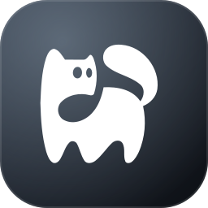
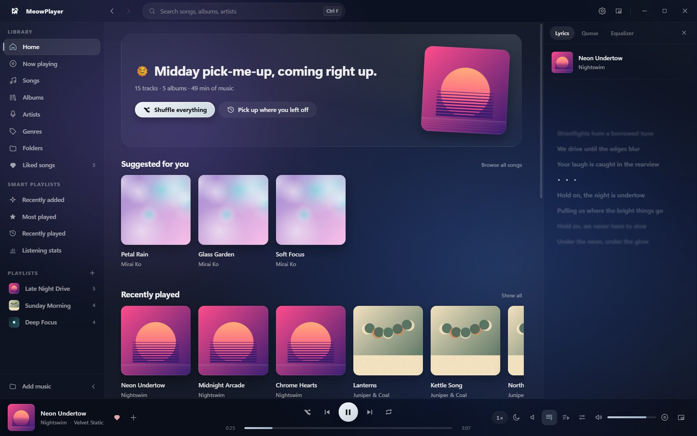
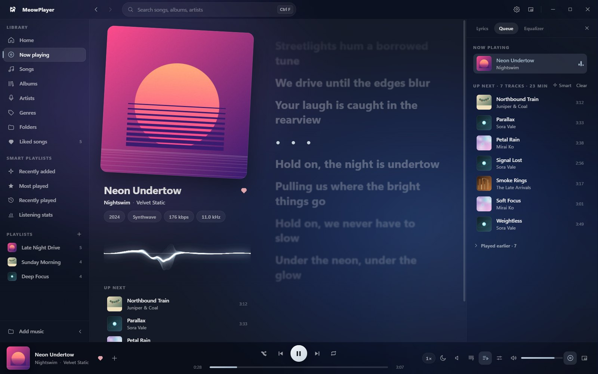
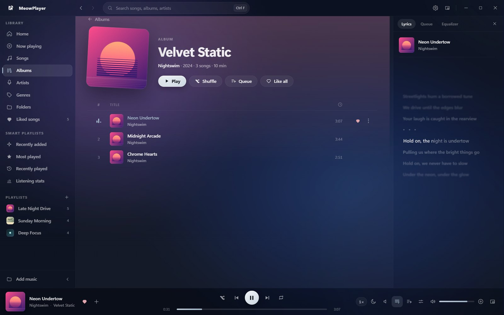
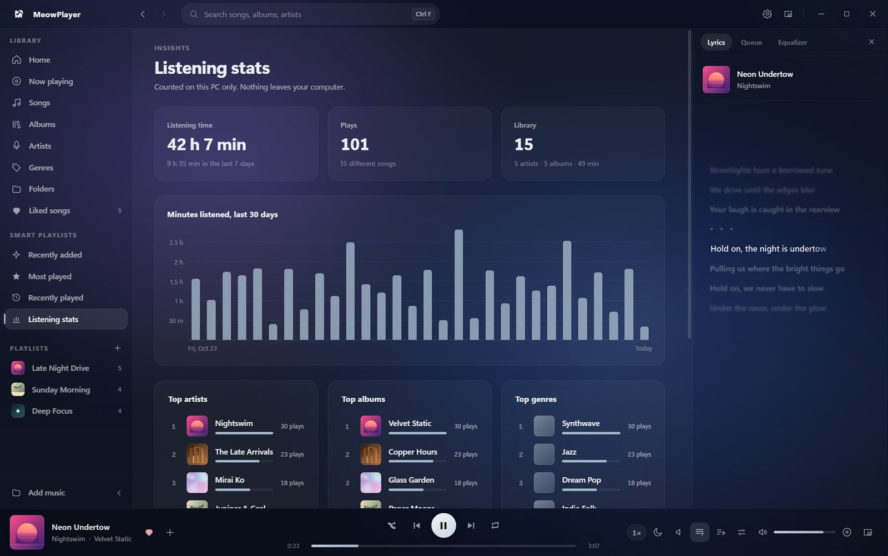
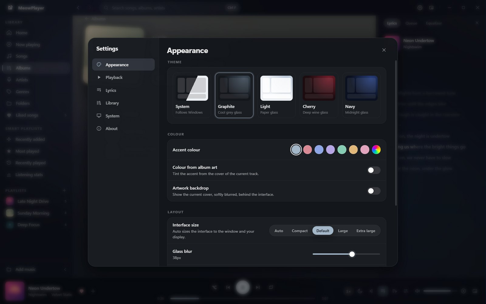
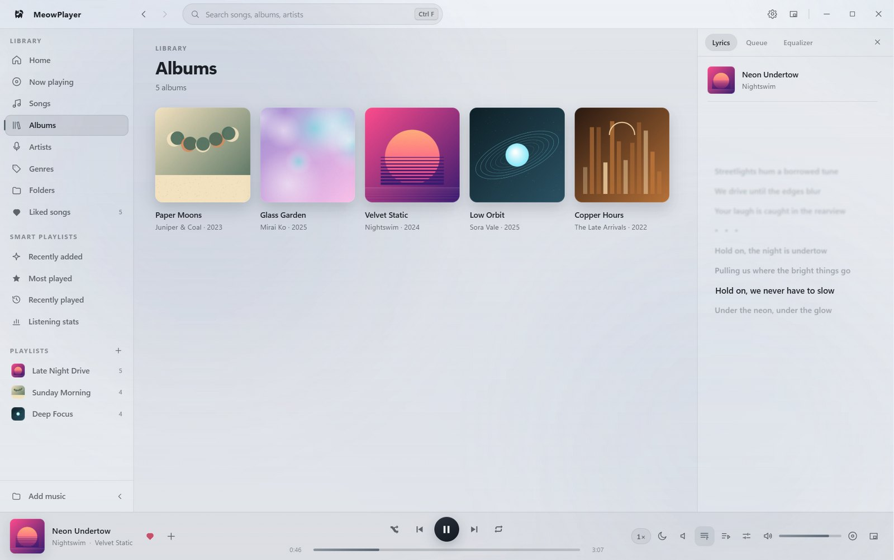
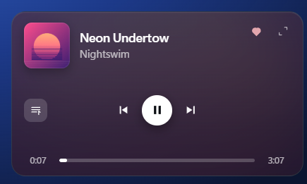

<div align="center">



# MeowPlayer

**A frosted-glass music player for your local library on Windows.**

Synced lyrics, a 10-band equalizer, gapless playback and crossfade, smart playlists
and listening stats, all in a calm glass interface that sits on top of your desktop.

[](https://github.com/AminMGM/MeowPlayer/releases/latest)
[](https://github.com/AminMGM/MeowPlayer/releases)
[](https://github.com/AminMGM/MeowPlayer/actions/workflows/ci.yml)
[](LICENSE)


[**Download for Windows**](https://github.com/AminMGM/MeowPlayer/releases/latest) ·
[What's new](CHANGELOG.md) ·
[Report a problem](https://github.com/AminMGM/MeowPlayer/issues)

<br>



</div>

## Features

### Listening

- **Plays everything you have.** MP3, FLAC, M4A/AAC, WAV, OGG/Opus, WMA and AIFF.
- **Synced lyrics** from [LRCLIB](https://lrclib.net), with the current line filling in as it is sung.
  Click any line to jump there, or download lyrics for your whole library to use offline.
- **Gapless playback and crossfade** of up to 12 seconds between tracks.
- **10-band equalizer** with presets, your own saved presets and a live curve.
- **Volume normalization** from the ReplayGain tags in your files, per track or per album.
- **A real shuffle.** Every song plays once before anything repeats, and Previous goes back to what you
  actually heard.
- **Sleep timer** that fades the music out, playback speed from 0.5× to 2×, and output device selection.

### Your library

- **Albums, artists, genres, folders and playlists**, with sortable song lists that stay fast in
  libraries with tens of thousands of tracks.
- **Smart playlists** that fill themselves: *Recently added*, *Most played* and *Recently played*.
- **Listening stats** for the last 7 days, 30 days or all time, a daily **listening streak**, and your
  top songs, artists, albums and genres. Counted on your PC only.
- **Type to search** on any list page, and an **A–Z scroller** for long song lists.
- **Fix song info**: better titles, artists, albums, years and missing artwork from file names and
  MusicBrainz, shown as a list of changes you tick before anything is written.
- **Edit track details** and the changes are written into the file, so every player sees them.
- **Watches your folders** and picks up new, changed or deleted files on its own.
- **Drag and drop** files or folders to play them right away, and import or export `.m3u8` playlists.
- **Import Spotify playlists** from a CSV export (for example from Exportify); they are rebuilt from the
  songs in your library.

### On your desktop

- **Frosted glass** over the Windows acrylic backdrop, in Graphite, Light, Cherry or Navy, or following
  your Windows light and dark mode. Pick an accent, or let it follow the album art.
- **Floating mini player** with the current lyric line, always on top.
- **Media keys, the Windows media overlay and taskbar buttons** all control playback.
- **System tray**: close the window and keep the music going.
- **Scales with your window**, from a small corner window to a 4K display.

<table>
  <tr>
    <td width="50%"></td>
    <td width="50%"></td>
  </tr>
  <tr>
    <td align="center"><sub>Now playing, with synced lyrics and the queue</sub></td>
    <td align="center"><sub>Album pages tinted by their artwork</sub></td>
  </tr>
  <tr>
    <td width="50%"></td>
    <td width="50%"></td>
  </tr>
  <tr>
    <td align="center"><sub>Listening stats</sub></td>
    <td align="center"><sub>Settings, grouped by category</sub></td>
  </tr>
  <tr>
    <td width="50%"></td>
    <td width="50%"></td>
  </tr>
  <tr>
    <td align="center"><sub>Light theme</sub></td>
    <td align="center"><sub>Navy theme</sub></td>
  </tr>
</table>

<p align="center">
  <br>
  <sub>The mini player floats above your other windows</sub>
</p>

## Download

Get **`MeowPlayer-Setup-<version>.exe`** from the
[latest release](https://github.com/AminMGM/MeowPlayer/releases/latest) and run it. MeowPlayer installs
into `C:\Program Files\MeowPlayer`, so Windows asks for permission once.

The installer is not code-signed yet, so Windows SmartScreen may say it does not recognise the app.
Choose **More info → Run anyway**.

**Updates** download inside the app and only fetch the parts that changed, usually a few megabytes. You
can keep listening while it downloads, then restart to update or let it install the next time you quit.
Every download is checked against the release before it runs.

To make MeowPlayer your default player, open **Settings → System → Default music player**.

## Keyboard shortcuts

| Keys | Action |
| --- | --- |
| <kbd>Space</kbd> | Play or pause |
| <kbd>←</kbd> <kbd>→</kbd> | Seek 5 seconds |
| <kbd>Ctrl</kbd> + <kbd>←</kbd> <kbd>→</kbd> | Previous or next track |
| <kbd>↑</kbd> <kbd>↓</kbd> | Volume |
| <kbd>M</kbd> · <kbd>S</kbd> · <kbd>R</kbd> · <kbd>L</kbd> | Mute · shuffle · repeat · like |
| <kbd>Ctrl</kbd> + <kbd>F</kbd> | Search |
| <kbd>Alt</kbd> + <kbd>←</kbd> <kbd>→</kbd> | Back or forward (mouse side buttons work too) |
| <kbd>Enter</kbd> | Play the selected song |
| <kbd>Esc</kbd> | Close menus and dialogs, or clear a type-to-search |

In song lists, click to select, <kbd>Ctrl</kbd>/<kbd>Shift</kbd>-click to select several, double-click or
press <kbd>Enter</kbd> to play, and right-click for more. On list pages, typing letters filters the page
(so <kbd>M</kbd> <kbd>S</kbd> <kbd>R</kbd> <kbd>L</kbd> work as shortcuts on the other pages, or everywhere
when type to search is off).

## Privacy

MeowPlayer works offline and has no accounts, analytics or telemetry. It only goes online to:

- look up lyrics on [LRCLIB](https://lrclib.net) (sending the title, artist, album and length of the
  song), which you can turn off in **Settings → Lyrics**;
- look up song details on [MusicBrainz](https://musicbrainz.org) and artwork on the Cover Art Archive,
  only when you run **Fix song info** with the lookup ticked (sending the title and artist);
- check GitHub for a newer version, which you can turn off in **Settings → System**.

Your library, playlists and stats are stored in `%APPDATA%\MeowPlayer`.

## Building from source

You need [Node.js](https://nodejs.org) 22 or newer on Windows.

```bash
git clone https://github.com/AminMGM/MeowPlayer.git
cd MeowPlayer
npm install
npm run dev       # run with hot reload
npm run check     # typecheck, lint and unit tests
npm run dist      # build the installer into ./release
```

| Folder | What is in it |
| --- | --- |
| `electron/` | Main process: windows, tray, media protocol, library scanner, tag writing, lyrics, updater |
| `src/store/` | App state, split into slices (library, playback, collection, lyrics, settings, UI) |
| `src/audio/` | The two-deck Web Audio engine: crossfade, gapless, EQ, normalization |
| `src/components/`, `src/views/` | The interface |
| `src/styles/` | Design tokens, themes and styles |
| `tests/` | Unit tests (Vitest) |
| `build/` | Installer artwork |

Releasing a new version is described in [docs/RELEASING.md](docs/RELEASING.md).

## Contributing

Bug reports and ideas are welcome in [Issues](https://github.com/AminMGM/MeowPlayer/issues). For pull
requests, please run `npm run check` first and keep changes focused.

## License

[MIT](LICENSE) © AminMGM. Lyrics are provided by [LRCLIB](https://lrclib.net).
The screenshots use a demo library with made-up artists and original artwork.
